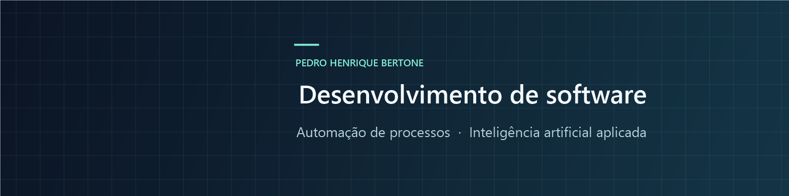

# Pedro Henrique Bertone

**Desenvolvimento de soluções digitais · Automação de processos · Desenvolvimento assistido por IA**

Cravinhos, São Paulo, Brasil

[Portfólio](#projetos) · [LinkedIn](https://www.linkedin.com/in/pedro-bertone-0890822b5/) · [Contato](mailto:pedrohbertone@outlook.com)

Atuo há mais de 12 anos em Tecnologia da Informação, com experiência em suporte técnico, redes, aplicações corporativas e sistemas ERP. Essa trajetória aproxima meu trabalho das necessidades de quem utiliza o software no dia a dia.

Hoje também desenvolvo soluções próprias com apoio de inteligência artificial, participando da concepção, do levantamento de requisitos, da estruturação de funcionalidades, dos testes e do aprimoramento dos sistemas. Meu foco está em organizar processos e transformar necessidades reais em aplicações funcionais.

## Projetos

### [CR Gestão Rural](https://github.com/Sydenci/cr-gestao-rural-portfolio)

**Em uso operacional · Gestão de propriedades e arrendamentos rurais**

Organização de propriedades, participantes, vínculos, regras de divisão financeira e vencimentos por competência. O versionamento das regras permite preservar o histórico dos ciclos anteriores.

Tecnologias do projeto — Next.js, TypeScript, PostgreSQL, Supabase e Expo.

[Conhecer o projeto e as capturas](https://github.com/Sydenci/cr-gestao-rural-portfolio)

### [Sydencare](https://github.com/Sydenci/sydencare-portfolio)

**Em desenvolvimento · Gestão de clínicas e consultórios**

Agenda por profissional e por equipe, ficha do paciente, prontuário, formulários configuráveis e controles administrativos. A apresentação distingue os recursos implementados da simulação local de atendimento.

Tecnologias do projeto — React, TypeScript e Tauri.

[Conhecer o projeto e as capturas](https://github.com/Sydenci/sydencare-portfolio)

### [Agenda Inteligente](https://github.com/Sydenci/agenda-inteligente-portfolio)

**Aplicativo Windows · Organização pessoal com armazenamento local**

Tarefas, compromissos, lembretes e metas recorrentes, com calendário, histórico e relatórios mensais. Os avisos funcionam com o aplicativo em execução, inclusive na bandeja.

Tecnologias do projeto — Electron, React, TypeScript e SQLite.

[Conhecer o projeto e as capturas](https://github.com/Sydenci/agenda-inteligente-portfolio)

## Trajetória profissional

- **Cred Rural · Técnico de Informática** — 2014–2022 e 2023–atual. Suporte a usuários, redes, impressoras e aplicações. Criação de utilitários para planilhas Excel, arquivos PDF e tarefas administrativas recorrentes.
- **Benner|RP · Estagiário em Suporte Técnico de Sistemas ERP** — 2022–2023. Atendimento a usuários e investigação de problemas no ERP Benner, incluindo demandas de clientes corporativos.

## Formação e base técnica

**Ciências da Computação · Universidade de Franca (UNIFRAN)** — curso concluído.

Formação complementar na Alura, com 75 horas certificadas em SQL/SQLite, fundamentos de programação, Power BI, inteligência artificial e soft skills.

Minha experiência prática inclui suporte técnico, redes, sistemas ERP, automação de planilhas e PDFs, levantamento de requisitos e testes funcionais. Python, JavaScript, SQL/SQLite e Power BI também fazem parte dos meus estudos de formação. As tecnologias indicadas nos projetos descrevem as soluções construídas com apoio de IA.

Português nativo e inglês intermediário-avançado, em aperfeiçoamento.

## Contato

Tenho interesse em oportunidades de desenvolvimento de software, automação de processos e soluções tecnológicas.

[LinkedIn](https://www.linkedin.com/in/pedro-bertone-0890822b5/) · [pedrohbertone@outlook.com](mailto:pedrohbertone@outlook.com)

Os projetos estão apresentados em repositórios de portfólio, com documentação e imagens demonstrativas. O código-fonte das aplicações permanece privado.
